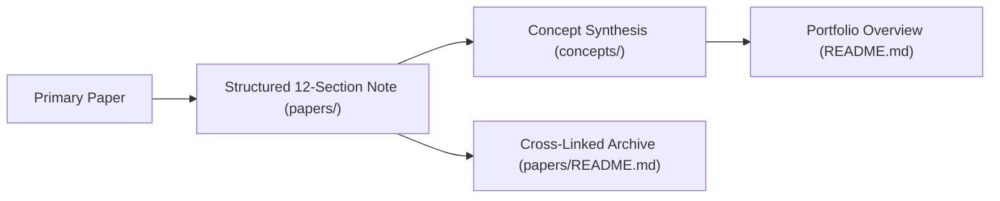

# Concept Notes

[← Back to Home](../README.md)

Concept notes synthesize recurring biological mechanisms, experimental assays, and computational methods encountered across multiple primary papers.

## Literature-to-Concept Workflow

## Example Mathematical Notation

Standard classification evaluation metrics used across sequence prediction benchmarks can be written directly in GitHub Markdown:

$$\text{Precision} = \frac{\text{TP}}{\text{TP} + \text{FP}}, \qquad \text{Recall} = \frac{\text{TP}}{\text{TP} + \text{FN}}$$

## Topics to Develop

- Add dedicated Markdown pages in `concepts/` as recurring themes accumulate across notes (for example: *CRISPR-Cas12a PAM Recognition*, *Chromatin Accessibility & ATAC-seq*, *One-Hot Sequence Convolutional Neural Networks*).
